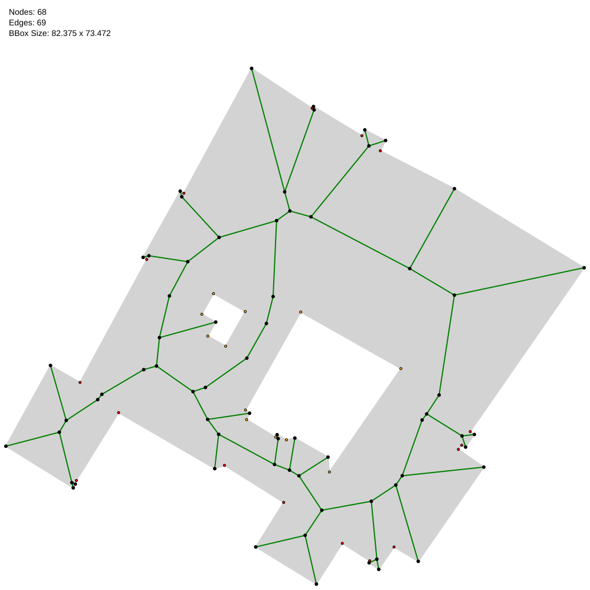

# polygon-medial-axis-graph

Computes **medial axis graphs** of polygons with holes, such as building footprints. The output is a coarse geometric graph that approximates the medial axis with straight-line edges.

This code is the preprocessing step of [geomGMD](https://github.com/lbuelte/geomGMD), a similarity measure for polygons based on their medial axis graphs. You don't need geomGMD to use it.



*Medial axis graph (black nodes, green/blue edges) of an OpenStreetMap building with two courtyards. Red and orange dots are the vertices of the outer boundary and of the holes.*

## What is a medial axis graph?

The **medial axis** of a polygon is the set of all points inside the polygon that have at least two closest points on the polygon boundary. It consists of straight segments and parabolic arcs. Parabolic arcs appear near reflex (non-convex) polygon vertices.

The **medial axis graph** turns the medial axis into a geometric graph:

- **Nodes** are the endpoints of the medial-axis curves:
  - branching points
  - convex polygon vertices
  - points where a parabolic arc meets a straight segment (these nodes have degree 2)
- **Edges** connect the two endpoints of each curve. Parabolic arcs are replaced by straight-line edges.

For a polygon without holes the graph is a tree. For a polygon with *h* holes it has *h* independent cycles.

## How it works

For each polygon (default values of the [parameters](#parameters) in brackets):

1. **Read and normalise:**
   - shift all coordinates so the dataset's minimum x and y become (0, 0)
   - round coordinates to millimetres
   - orient the outer boundary counterclockwise and holes clockwise
2. **Prune the polygon:**
   - remove nearly collinear boundary vertices (angle within 2° of 180°)
   - merge consecutive vertices closer than min(0.01, 0.001 × bounding-box diagonal)
   - move hole vertices that touch the outer boundary slightly away from it (0.01)
3. **Check validity** (simple rings, no vertices closer than 10⁻⁴, no angle within 2° of 180°, ...). If the polygon is invalid, perturb its vertices randomly by at most 10⁻⁵ × bounding-box diagonal (with a fixed seed) and go back to step 2. After 1000 unsuccessful perturbations the polygon is skipped with a warning.
4. **Compute the Voronoi diagram** of the boundary vertices and boundary edges, using CGAL's [segment Delaunay graph](https://doc.cgal.org/latest/Segment_Delaunay_graph_2/index.html).
5. **Extract the medial axis:** keep the Voronoi edges whose midpoint lies inside the polygon and that are not incident to a reflex polygon vertex (or one within 2° of straight). Their endpoints become the nodes of the graph.

## Requirements

| Dependency | Version | Notes |
|---|---|---|
| C++ compiler | C++17 | tested with GCC 11.4 |
| CMake | ≥ 3.16 | |
| [CGAL](https://www.cgal.org) | ≥ 6.0 | tested with 6.0.1; header-only, needs Boost, GMP and MPFR |
| [GDAL](https://gdal.org) | ≥ 3.0 | tested with 3.8.4; reads the GeoPackage input |

[nlohmann/json](https://github.com/nlohmann/json) 3.12.0 and [toml++](https://github.com/marzer/tomlplusplus) 3.4.0 are included in `external/`.

On Ubuntu/Debian:

```bash
sudo apt install build-essential cmake libgdal-dev libboost-dev libgmp-dev libmpfr-dev
```

Older Ubuntu releases ship CGAL 5.x. CGAL is header-only, so you can download the 6.0.1 release instead of installing a package:

```bash
wget https://github.com/CGAL/cgal/releases/download/v6.0.1/CGAL-6.0.1-library.tar.xz
tar xf CGAL-6.0.1-library.tar.xz
# then pass -DCGAL_DIR=$PWD/CGAL-6.0.1/lib/cmake/CGAL to cmake (see below)
```

## Build

```bash
cmake -B build -DCMAKE_BUILD_TYPE=Release    # add -DCGAL_DIR=... if CGAL is not found
cmake --build build -j
```

This builds the library `medial_axis_graph_lib`, the command line tool `medial_axis_graph` and a test.

## Usage

Run on the example data from the repository root:

```bash
./build/medial_axis_graph --input examples/data --output output/examples
```

This processes the two example datasets in `examples/data/`, prints one summary line per dataset and writes:

```
output/examples/synthetic/synthetic_graphs.json
output/examples/synthetic/params_used.toml
output/examples/synthetic/medial_axis_svgs/synthetic_<i>.svg
output/examples/osm_poppelsdorf/...
```

All options:

```
--input DIR                  folder containing one subfolder per dataset (required)
--output DIR                 folder for the results, created if needed (required)
--dataset NAME               process only this dataset (can be repeated);
                             default: every subfolder of the input folder
--params FILE                algorithm parameters (TOML); default: built-in defaults
--perturb-instances FILE     perturb the listed instances before computing them (can be repeated)
--no-svg                     do not write SVG drawings
--svg-parabolas              draw parabolic medial axis edges as curves in the SVGs
--verbose                    also print a message for every file written
--print-default-params       print all parameters with their defaults and exit
--help                       print the usage and exit
```

Warnings, e.g. about skipped polygons, go to stderr and name the instance as `[<dataset>|<index> id=<id>]`. Usage and parameter errors exit with code 2, other errors with code 1.

Run the test, which checks that the example graphs are connected and simple:

```bash
ctest --test-dir build --output-on-failure
```

## Parameters

The algorithm parameters have built-in defaults (the values used for the paper). To change some of them, write a TOML file with only those values and pass it with `--params`, for example [`examples/params.toml`](examples/params.toml):

```toml
[polygon_pruning]
merge_distance = 0.05            # merge consecutive vertices closer than 5 cm (default: 1 cm)
```

`./build/medial_axis_graph --print-default-params` prints all parameters with their default values and descriptions; its output is a valid parameter file. Unknown sections or keys (e.g. typos) are reported as errors.

| Section | Key | Default | Meaning |
|---|---|---|---|
| `polygon_pruning` | `collinearity_threshold_deg` | 2.0 | remove vertices whose angle is within this many degrees of 180 |
| | `merge_distance` | 0.01 | merge consecutive vertices closer than this distance ... |
| | `merge_distance_rel_bbox` | 0.001 | ... or than this fraction of the bounding box diagonal (smaller threshold is used) |
| | `hole_vertex_offset` | 0.01 | distance by which hole vertices that touch the outer boundary are moved off it |
| `validity` | `min_vertex_distance` | 1e-4 | minimum distance between any two vertices |
| | `collinearity_threshold_deg` | 2.0 | no vertex angle may be within this many degrees of 180 |
| `perturbation` | `seed` | 42 | seed of the random perturbations (results are reproducible) |
| | `max_displacement_rel_bbox` | 1e-5 | maximum displacement per coordinate, as a fraction of the bounding box diagonal |
| `medial_axis` | `reflex_tolerance_deg` | 2.0 | vertices within this many degrees of 180 are treated like reflex vertices |
| `medial_axis_pruning` | ... | | pruning of the medial axis graph; not used by the pipeline yet |

Distances are in the units of the input coordinates (metres). Every run writes the parameters it used to `<output>/<dataset>/params_used.toml`.

## Input format

Each dataset is a [GeoPackage](https://www.geopackage.org) stored as

```
<input>/<dataset>/<dataset>.gpkg
```

- Only the first layer is read. Its geometries must be `Polygon` or `MultiPolygon`. MultiPolygons with more than one part are skipped with a warning, so that ids stay unique.
- Polygons with degenerate rings (fewer than 3 distinct points), and polygons that cannot be made valid by pruning and perturbation (e.g. a self-intersecting boundary), are skipped with a warning. They get no entry in the output.
- The integer attribute `id` is used as the polygon ID. If it is missing, the feature ID is used instead.
- Coordinates should be in a **projected CRS in metres**, because the pruning thresholds are absolute distances. The CRS metadata itself is ignored.
- Holes are supported.

The examples are:

- `examples/data/synthetic/`: simple shapes (rectangle, L, T, U, square, square with a courtyard), generated from the readable [`synthetic.csv`](examples/data/synthetic/synthetic.csv) with
  ```bash
  ogr2ogr -f GPKG synthetic.gpkg synthetic.csv -oo GEOM_POSSIBLE_NAMES=wkt -oo KEEP_GEOM_COLUMNS=NO \
          -oo AUTODETECT_TYPE=YES -nln polygons -nlt POLYGON
  ```
- `examples/data/osm_poppelsdorf/`: nine building footprints from Bonn-Poppelsdorf, Germany (ETRS89 / UTM zone 32N), from OpenStreetMap.

## Output format

For each dataset, `<output>/<dataset>/<dataset>_graphs.json` contains one entry per polygon:

```json
{
  "graphs": [
    {
      "id": 1951,
      "polygon": {
        "outer": [{"x": 12.5, "y": 3.0}, ...],
        "holes": [[{"x": 20.1, "y": 8.4}, ...], ...]
      },
      "medial_axis": {
        "vertices": [{"x": 14.2, "y": 5.1}, ...],
        "edges": [{"source": 0, "target": 3}, ...]
      }
    }
  ]
}
```

- `medial_axis.vertices` are the **nodes** of the medial axis graph. `edges` refer to them by index.
- `polygon` is the polygon *after* pruning (and perturbation, if any). The medial axis graph was computed from this polygon.
- All coordinates are in the shifted frame of the dataset: the dataset's minimum x and y were subtracted.
- The graph is undirected, and edges are straight-line segments between their nodes.

Unless `--no-svg` is given, an SVG drawing of each polygon and its medial axis graph is also written to `medial_axis_svgs/`. With `--svg-parabolas`, parabolic arcs are drawn as curves (blue) instead of straight lines (green). This only affects the drawing; the JSON is the same.

## Handling instances where CGAL hangs or crashes

On a few real-world polygons, CGAL's segment Delaunay graph does not terminate or crashes. [`scripts/watchdog.sh`](scripts/watchdog.sh) runs the tool, detects instances that make no progress for a given time or cause a segmentation fault, records them (dataset name and polygon index) in `scripts/stuck_instances.txt` and `scripts/segfault_instances.txt`, and restarts the run. It passes both lists to the tool with `--perturb-instances`, so these instances are perturbed (as in step 3 above) before their medial axis is computed.

```bash
scripts/watchdog.sh [timeout_seconds] -- <medial_axis_graph arguments>    # run from the repository root
scripts/watchdog.sh 10 -- --input input --output output --no-svg
```

The lists in this repository are those from the experiments in the paper (Bonn and Siegburg datasets).

## Reproducing the paper's graphs

With the Bonn and Siegburg datasets in `input/`:

```bash
./build/medial_axis_graph --input input --output output --no-svg \
    --perturb-instances scripts/stuck_instances.txt --perturb-instances scripts/segfault_instances.txt
```

Since the paper, two bugs in the polygon pruning have been fixed (a group of close vertices across the start of a ring, and two adjacent vertices removed in the same pass). This changes 9 of the 119,229 Bonn graphs slightly. The code exactly as used for the paper is commit `4aa0d5e`.

## Known limitations

- **Run-to-run variation:** for a handful of polygons (1–2 of 119,229 per pair of runs in the Bonn data), the medial axis graph can differ between two runs on the same input. The cause is CGAL's segment Delaunay graph traits used here (`Segment_Delaunay_graph_traits_2`), which evaluate geometric predicates in floating point. In nearly degenerate configurations, common in rectilinear buildings, a predicate can then go either way, depending on CGAL's internal processing order and thus on memory addresses. Two examples from the Bonn data:
  - Hochkreuz-Bundesviertel, id 392 (279 vertices): a Voronoi vertex where many sites are nearly cocircular is split differently, so one node lies 2.8 m apart between runs and the edges next to it change.
  - Röttgen, id 207: a 2.5 m medial axis edge whose midpoint lies only 0.3 mm from the polygon boundary is kept in one run and dropped in another.

  With CGAL's filtered traits (`Segment_Delaunay_graph_filtered_traits_2`, exact predicates) the results are deterministic, and CGAL no longer hangs or crashes on the problematic instances. However, this changes 1.4 % of the Bonn graphs (and more of them become disconnected: 196 instead of 89), so the paper's traits are kept for now. The order of nodes in the JSON can also differ between runs.
- **Disconnected graphs:** about 0.07 % of the graphs (89 of 119,229 in the Bonn data) are not connected, although the medial axis of a polygon is.
- **Validity check:** it does not check that holes lie inside the outer boundary or that holes do not intersect each other.

## Repository structure

```
apps/        command line tool (main.cpp)
include/     headers of the library
src/         library sources: medial axis graph, pipeline, parameters, polygon pruning, I/O
tests/       test on the example data
examples/    small example datasets and an example parameter file
scripts/     watchdog script and lists of problematic instances
docs/        images for this README
external/    vendored header-only libraries (nlohmann/json, toml++)
```

## Related

- [geomGMD](https://github.com/lbuelte/geomGMD): polygon similarity based on medial axis graphs, which uses the output of this repository.

## Citation

If you use this code, please cite:

> Laura Bülte, Alexander Naumann, Johanna Schlurmann, Jan-Henrik Haunert, and Petra Mutzel. 2026. geomGMD: Translation- and Rotation-Invariant Geometric Graph Mapping Distance for Building Footprint Similarity. In *The 34th ACM International Conference on Advances in Geographic Information Systems (SIGSPATIAL '26)*, November 03–06, 2026, Riverside, CA, USA. ACM, New York, NY, USA, 13 pages. https://doi.org/10.1145/3841645.3844193

```bibtex
@inproceedings{buelte2026geomgmd,
  author    = {B{\"u}lte, Laura and Naumann, Alexander and Schlurmann, Johanna and Haunert, Jan-Henrik and Mutzel, Petra},
  title     = {{geomGMD}: Translation- and Rotation-Invariant Geometric Graph Mapping Distance for Building Footprint Similarity},
  booktitle = {The 34th ACM International Conference on Advances in Geographic Information Systems (SIGSPATIAL '26)},
  year      = {2026},
  month     = nov,
  address   = {Riverside, CA, USA},
  publisher = {ACM},
  numpages  = {13},
  doi       = {10.1145/3841645.3844193}
}
```

## License

The code in this repository is licensed under the [MIT License](LICENSE).

Note that it uses CGAL packages licensed under GPL-3.0-or-later (see below). Executables built from this code include these packages and are therefore subject to the GPL when distributed.

Third-party components:

- CGAL: GPL-3.0-or-later / LGPL-3.0-or-later, depending on the package. The segment Delaunay graph and Voronoi diagram packages used here are GPL-3.0-or-later.
- nlohmann/json and toml++: MIT (license files in `external/`).
- The example data in `examples/data/osm_poppelsdorf/` is © [OpenStreetMap](https://www.openstreetmap.org/copyright) contributors and available under the [Open Database License (ODbL)](https://opendatacommons.org/licenses/odbl/).
